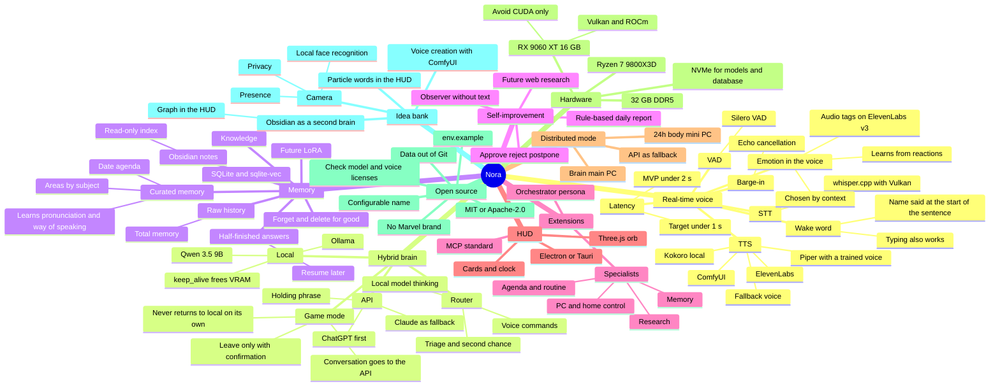
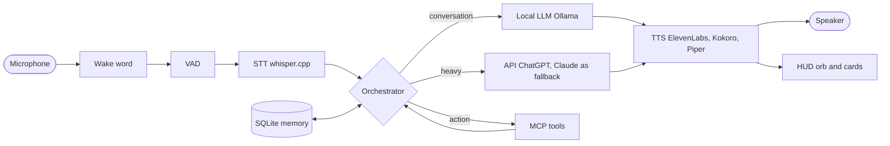
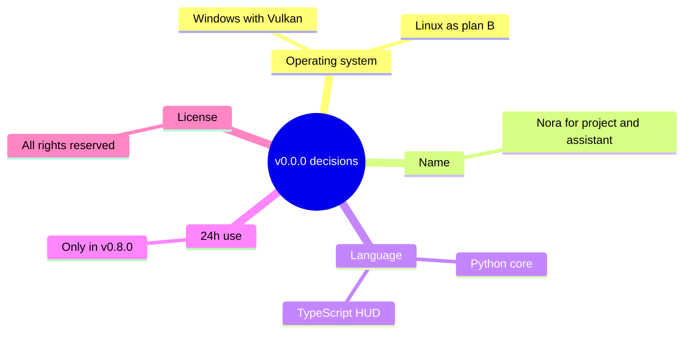

# Project mind map

> Project overview in diagrams. GitHub draws the `mermaid` blocks automatically.
> **Rule:** every finished stage updates this file, changing the status in the roadmap and adding new nodes to the map.
> Editable visual version in Obsidian: [`MAPA_MENTAL.canvas`](MAPA_MENTAL.canvas) (see [`OBSIDIAN.md`](OBSIDIAN.md)).
> Detailed source: [`PROJETO_ASSISTENTE_IA.md`](../PROJETO_ASSISTENTE_IA.md).
> References studied: [`referencias/`](referencias/video-01-assistente-local.md).

**Roadmap legend:** ✅ done · 🔄 in progress · ⬜ pending

**Versions:** `vMAJOR.MINOR.PATCH`. Each stage bumps the middle number (`v0.1.0` → `v0.2.0`), and fixes within a stage bump the last one (`v0.1.0` → `v0.1.1`). Details in section 5 of [`PROJETO_ASSISTENTE_IA.md`](../PROJETO_ASSISTENTE_IA.md).

---

## 1. Overview

---

## 2. Roadmap by stage

| Version | Stage | Status | Done criterion |
|---|---|---|---|
| v0.0.0 | Foundation | ✅ | The project runs "hello world" and the config loads |
| v0.1.0 | Voice conversation | ✅ | Say the name, ask and hear the answer in under 2 s |
| v0.2.0 | Memory | ✅ | Remembers facts across sessions |
| v0.3.0 | Model router | ✅ | A hard question goes to the API and comes back in the same voice |
| v0.4.0 | HUD | ⬜ | Interface reacts to the voice in real time |
| v0.5.0 | MCP tools | ⬜ | Performs actions by voice |
| v0.6.0 | Routines and initiative | ⬜ | The AI speaks first on schedule and on presence |
| v0.7.0 | Agents and subagents | ⬜ | Complex tasks delegated |
| v0.8.0 | Distributed mode | ⬜ | Works with the PC off, via the API |
| v1.0.0 | Launch | ⬜ | Third parties install and use it |

---

## 3. Flow of a conversation

---

## 4. Decisions made (30/10/2026)

