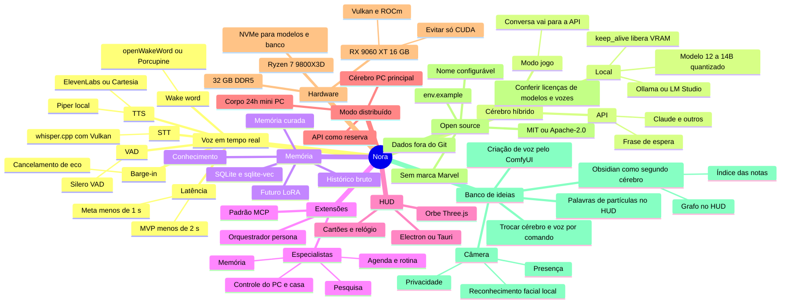
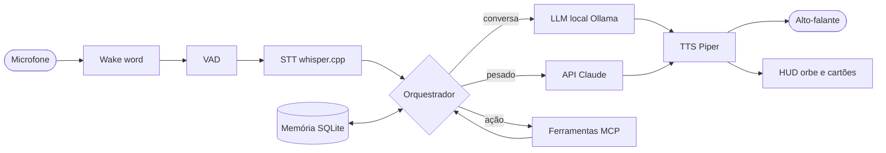
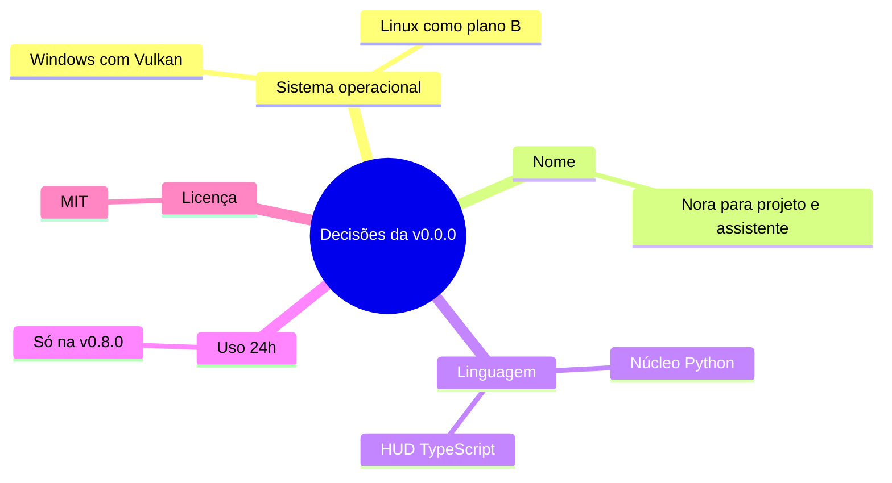

# Mapa mental do projeto

> Visão geral do projeto em diagramas. O GitHub desenha os blocos `mermaid` automaticamente.
> **Regra:** toda etapa concluída atualiza este arquivo, mudando o status no roadmap e incluindo nós novos no mapa.
> Versão visual editável no Obsidian: [`MAPA_MENTAL.canvas`](MAPA_MENTAL.canvas) (veja [`OBSIDIAN.md`](OBSIDIAN.md)).
> Fonte detalhada: [`PROJETO_ASSISTENTE_IA.md`](../PROJETO_ASSISTENTE_IA.md).
> Referências estudadas: [`referencias/`](referencias/video-01-assistente-local.md).

**Legenda do roadmap:** ✅ concluída · 🔄 em andamento · ⬜ pendente

**Versões:** `vMAIOR.MENOR.CORREÇÃO`. Cada etapa sobe o número do meio (`v0.1.0` → `v0.2.0`), e ajustes dentro de uma etapa sobem o último (`v0.1.0` → `v0.1.1`). Detalhes na seção 5 de [`PROJETO_ASSISTENTE_IA.md`](../PROJETO_ASSISTENTE_IA.md).

---

## 1. Visão geral

---

## 2. Roadmap por etapas

| Versão | Etapa | Status | Critério de pronto |
|---|---|---|---|
| v0.0.0 | Fundação | ✅ | Projeto roda o "hello world" e a config carrega |
| v0.1.0 | Conversa por voz | ✅ | Falar o nome, perguntar e ouvir a resposta em menos de 2 s |
| v0.2.0 | Memória | 🔄 | Lembra de fatos entre sessões |
| v0.3.0 | Roteador de modelos | ⬜ | Pergunta difícil vai para a API e volta com a mesma voz |
| v0.4.0 | HUD | ⬜ | Interface reage à voz em tempo real |
| v0.5.0 | Ferramentas MCP | ⬜ | Executa ações por voz |
| v0.6.0 | Rotinas e iniciativa | ⬜ | IA fala primeiro no horário e por presença |
| v0.7.0 | Agentes e subagentes | ⬜ | Tarefas complexas delegadas |
| v0.8.0 | Modo distribuído | ⬜ | Funciona com o PC desligado, via API |
| v1.0.0 | Lançamento | ⬜ | Terceiros instalam e usam |

---

## 3. Fluxo de uma conversa

---

## 4. Decisões tomadas (30/10/2026)

